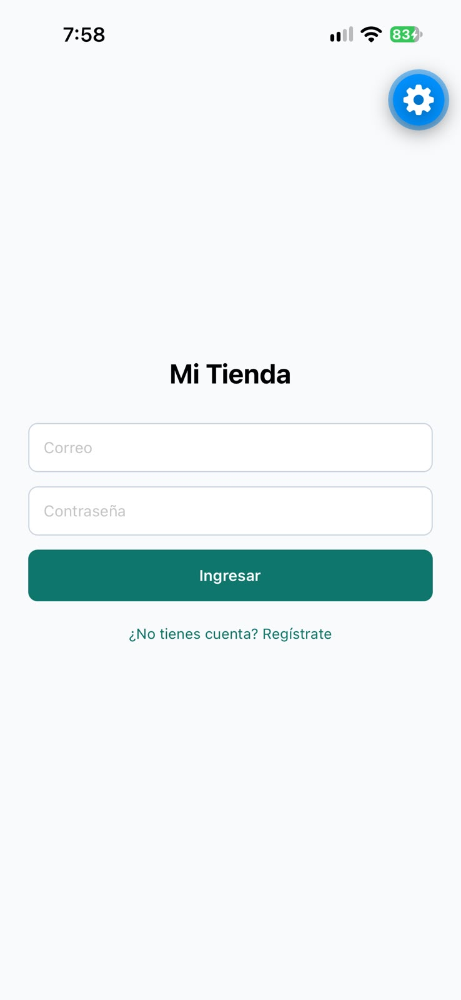
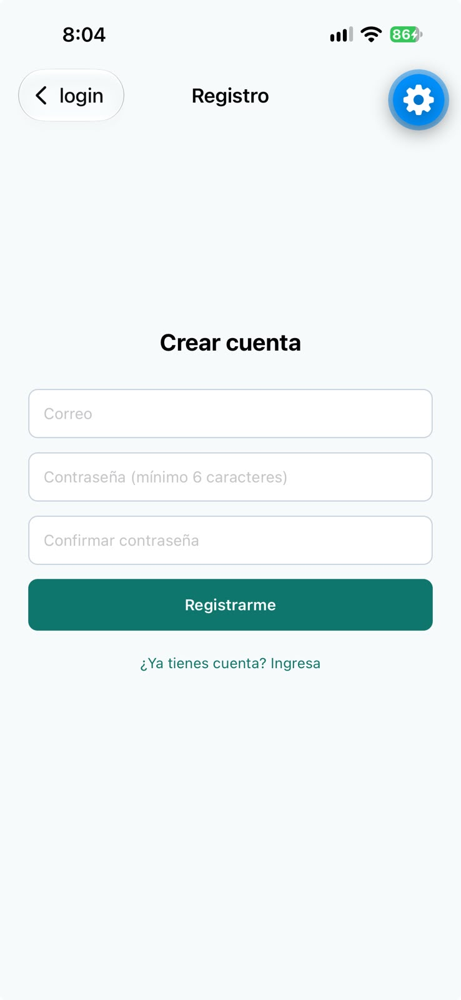
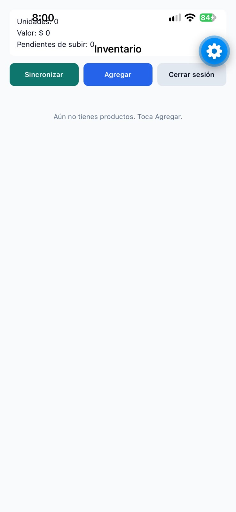
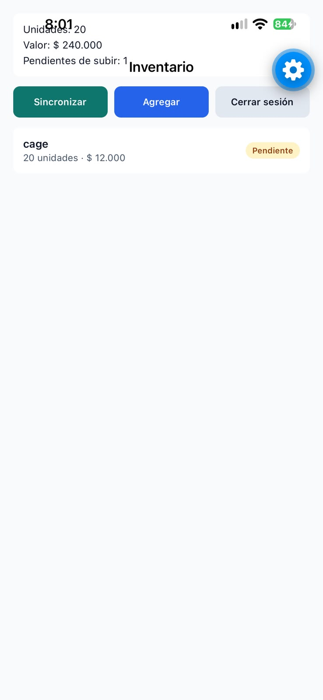
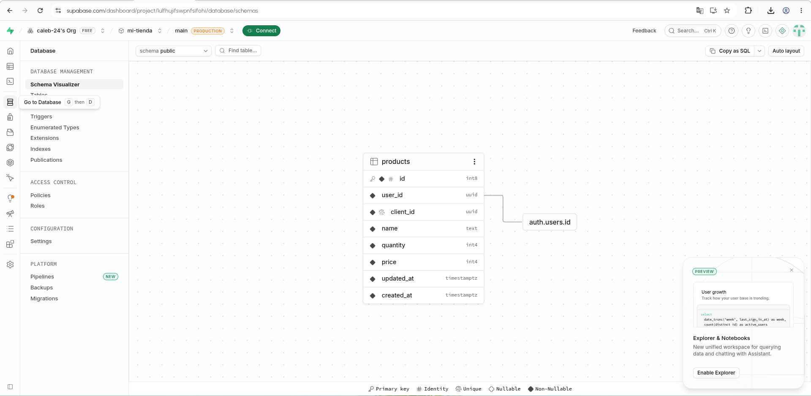

# Mi Tienda — App móvil con base de datos local y en la nube

Parcial de la Semana 9. App de inventario para una tienda de barrio: el tendero inicia sesión, registra productos aunque no tenga internet y los respalda en Supabase al sincronizar.

**Nombre:** Caleb Reyes De Los Reyes
**Código:** 0182210056

## Tecnología

- Expo SDK 57 con TypeScript y Expo Router
- SQLite con Drizzle ORM (fuente de verdad local)
- Supabase: autenticación por correo y contraseña, y tabla `products` con RLS

## Cómo ejecutar el proyecto

1. Crear un archivo `.env` en la raíz, copiando `.env.example`, y completar:
   ```
   EXPO_PUBLIC_SUPABASE_URL=https://lulfhujifswpnfsifohi.supabase.co
   EXPO_PUBLIC_SUPABASE_PUBLISHABLE_KEY=sb_publishable_8vpeZnXEfuQBwUDU3qCrWg_VCE0lcbx
   ```
   Solo la publishable key. Nunca la secret key. Ambos valores están en tu proyecto de Supabase, en Project Settings → API Keys.
2. En Supabase: desactivar la confirmación por correo (Authentication → Providers → Email) y ejecutar el contenido de `supabase/schema.sql` en el SQL Editor.
3. Instalar y arrancar:
   ```
   npm install
   npx expo start
   ```

La migración de SQLite ya está generada en `drizzle/`. Si cambias `db/schema.ts`, ejecuta `npx drizzle-kit generate`.

## Estructura

```
app/                  pantallas (Expo Router)
  _layout.tsx         migraciones, sesión y rutas protegidas
  login.tsx           inicio de sesión
  registro.tsx        registro con validaciones
  index.tsx           inventario: totales, sincronizar, agregar, cerrar sesión
  producto.tsx        formulario crear / editar
context/AuthContext.tsx   sesión de Supabase (signIn, signUp, signOut)
db/                   esquema de Drizzle, cliente SQLite y repositorio de productos
hooks/                useProducts (lista reactiva) y useProductForm
services/sync.ts      syncProducts(userId): bajar y luego subir
lib/                  SecureStore para la sesión, cliente de Supabase, validaciones
supabase/schema.sql   tabla products con RLS
```

## Capturas









## Qué quedó funcionando

- Registro con validaciones (correo, mínimo 6 caracteres, contraseñas que coinciden) e inicio de sesión con mensaje de error visible.
- Rutas protegidas con `Stack.Protected`: sin sesión solo existen Login y Registro; con sesión, Inventario y Producto.
- La sesión se guarda en SecureStore por fragmentos y sobrevive al cierre de la app.
- Crear, editar y eliminar productos en SQLite, sin conexión. Eliminar pide confirmación manteniendo presionado el producto.
- Lista reactiva con total de unidades, valor total y cantidad de productos pendientes. Cada fila muestra "Pendiente" o "En la nube".
- Sincronizar: primero baja los productos de la nube que no existen en el teléfono y después sube los pendientes con upsert por `client_id`. Muestra el resultado ("2 subidos, 1 bajados") o el error.

## Qué no quedó o tiene limitaciones

- **Los borrados no se sincronizan.** Un producto eliminado en el teléfono sigue en Supabase y vuelve a aparecer al pulsar Sincronizar. Estaba fuera de alcance.
- **Sin resolución de conflictos.** Si un producto cambió en la nube y en el teléfono, gana el de la última subida; no se compara fecha.
- **Los datos locales no están separados por usuario.** La tabla `products` no tiene columna de dueño (así lo pide el enunciado). Si otra cuenta inicia sesión en el mismo teléfono, verá los productos del anterior y los subirá a su cuenta.
- **Sincronización manual.** No hay sincronización automática al recuperar la conexión.
- No hay búsqueda por nombre ni TanStack Query.
